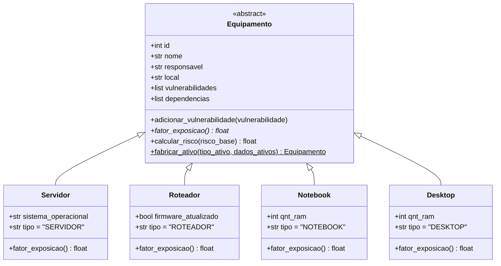

<div align="center">

# 🛡️ CyberPixel — SOC Level 3 [Visual Interface]

**Simulador Interativo de Centro de Operações de Segurança (SOC), Gestão de Ativos de TI, Vulnerabilidades (CVEs) e Propagação Matricial de Risco**


</div>

---

## 🎬 Demonstração: Registro de Vulnerabilidade e Mudança de Cenário

Ao registrar uma vulnerabilidade em um ativo, o **CyberPixel SOC** recalcula instantaneamente o nível de ameaça da rede e transforma o cenário visual:
1. **Estado Seguro:** Workstation e LEDs dos racks do servidor operam em **verde Matrix**, com o telão central exibindo `SISTEMA 100% SEGURO`.
2. **Registro de Incidente (`VULN_PATCH`):** Ao vincular uma CVE (do catálogo local ou buscada ao vivo na **API da NVD**) a um equipamento, um incidente é aberto.
3. **Reação Dinâmica do Cenário:** A Workstation passa a piscar conforme a escala cromática de severidade (**Âmbar → Laranja → Vermelho Claro → Vermelho Crítico**) com um alerta flutuante (`👾`), os LEDs dos servidores entram em estado de alerta e o **Telão Central** destaca as ameaças ativas.
4. **Árvore de Infraestrutura e Propagação:** No rack do Servidor, a árvore topológica exibe o impacto do risco propagado para roteadores e endpoints da sala.

<div align="center">
  
</div>

---

## 🖥️ Estações Interativas do Cenário

Você interage clicando diretamente nos objetos do laboratório SOC:

| Estação no Cenário | Função no Sistema | O que você pode fazer |
| :--- | :--- | :--- |
| 💻 **Notebook** (`CRUD Ativos`) | Gerenciador de Inventário | **Listar / Buscar**, **Cadastrar**, **Atualizar** e **Remover** equipamentos (`Servidor`, `Roteador`, `Notebook`, `Desktop`) com prefixo automático de hostname (`serv`, `rotp`, `notp`, `micp`) e criação dinâmica de salas. |
| 🖥️ **Workstation** (`Incidentes`) | Gestão de Vulnerabilidades | **Registrar CVEs** (catálogo local ou busca assíncrona na NVD) e **Corrigir falhas** mediante registro obrigatório de log de auditoria. |
| 🗄️ **Servidor** (`JSON / Risco`) | Topologia e Matriz de Risco | Visualizar a **Árvore de Infraestrutura por Sala** (`Servidor → Roteador → Endpoints`) e inspecionar o **Risco Próprio** vs. **Risco Efetivo** de cada nó. |
| 📺 **Telão Central** (`Dashboard`) | Auditoria e Monitoramento | Alterna automaticamente entre **Logs em Tempo Real** e **Ameaças Ativas**, permitindo clicar para inspecionar detalhes completos de cada evento. |

---

## 🧬 Arquitetura Orientada a Objetos (POO)

O domínio de equipamentos em [`ativos.py`](ativos.py) foi modelado aplicando **Abstração**, **Herança**, **Polimorfismo** e o padrão **Simple Factory**:



<details>
<summary><b>🔍 Clique para ver como cada pilar de POO foi aplicado</b></summary>

<br>

* **Classe Abstrata (`ABC`):** `Equipamento` herda de `abc.ABC` e declara `@abstractmethod def fator_exposicao(self)`, garantindo que apenas equipamentos concretos sejam instanciados.
* **Herança (`super()`):** `Servidor`, `Roteador`, `Notebook` e `Desktop` herdam a estrutura base de `Equipamento` e estendem o modelo com atributos específicos (`sistema_operacional`, `firmware_atualizado`, `qnt_ram`).
* **Polimorfismo:** O método `calcular_risco()` na classe base invoca `self.fator_exposicao()`, cujo retorno varia polimorficamente conforme a classe concreta (`1.5` para servidores críticos e `0.8` para demais ativos). Além disso, vulnerabilidades registradas em instâncias de `Servidor` têm sua severidade elevada automaticamente para `critica`.
* **Factory Method (`@staticmethod`):** `Equipamento.fabricar_ativo(tipo, dados)` reconstrói polimorficamente os objetos de domínio a partir dos dicionários carregados do JSON.

</details>

---

## 📐 Álgebra Linear Aplicada: Propagação Matricial de Risco

Nos módulos [`CRUD/risco.py`](CRUD/risco.py) e [`CRUD/risco_salas.py`](CRUD/risco_salas.py), o risco cibernético não fica isolado em um único aparelho: ele se propaga pela topologia da rede utilizando **Matrizes e Sistemas Lineares** com `NumPy`.

### 1. Vetor de Risco Próprio ($b$) via Produto Matricial
Para $n$ equipamentos e $m$ vulnerabilidades abertas:
* Constrói-se a **Matriz de Incidência** $M \in \mathbb{R}^{n \times m}$, onde $M_{i,j} = 1$ se o equipamento $i$ possui a vulnerabilidade ativa $j$ (e $0$ caso contrário).
* Define-se o **Vetor de Severidades** $v \in \mathbb{R}^{m}$ com os pesos: `baixa = 1.0`, `media = 2.5`, `alta = 5.0`, `critica = 10.0`.
* O risco base de todos os equipamentos é obtido pelo produto matricial (`np.dot(M, v)`), ponderado pelo fator de exposição polimórfico $f_i$ de cada classe:

$$b_i = f_i \cdot (M \cdot v)_i$$

### 2. Matriz de Dependências ($A$) e Sistema Linear $(I - A)x = b$
A rede conecta **Endpoints (`Notebook`/`Desktop`) $\leftrightarrow$ `Roteador` $\leftrightarrow$ `Servidor`**. A matriz quadrada $A \in \mathbb{R}^{n \times n}$ registra a fração de propagação de risco entre os nós (incluindo propagação descendente do ativo-pai e ascendente de $25\%$ dos dependentes).

Como o **Risco Efetivo** $x$ de cada máquina é a soma do seu risco próprio $b$ com o risco herdado das conexões ($x = Ax + b$), resolvemos o sistema linear:

$$(I - A)x = b$$

* **Verificação de Invertibilidade:** Calcula-se o determinante $\det(I - A)$ via `np.linalg.det`. Se $\det(I - A) \approx 0$, o sistema detecta dependência cíclica crítica e bloqueia o cálculo.
* **Resolução Direta:** Caso $\det(I - A) \neq 0$, o vetor de risco efetivo $x$ é resolvido com `np.linalg.solve(I - A, b)`.

---

## 🌐 Integração com a API Oficial NIST / NVD (CVE 2.0)

O seletor de vulnerabilidades consulta a API pública da **National Vulnerability Database (NVD)** em tempo real conforme o usuário digita (3+ caracteres):
* **Execução Assíncrona (`NvdCveSearchWorker`):** Implementado em [`integracoes/nvd_api.py`](integracoes/nvd_api.py) com `threading.Thread` e `Queue` para nunca travar o loop gráfico de 50 FPS do Pygame.
* **Fallback Offline:** O catálogo local de CVEs (`Heartbleed`, `EternalBlue`, `Log4Shell`, `Spring4Shell`, etc.) continua disponível mesmo sem internet.
* **Rate Limit & Cache:** Possui cache em memória e controle automático de *rate limit* (opcionalmente acelerado definindo a variável de ambiente `NVD_API_KEY`).

---

## 🚀 Como Executar o Projeto

### 1. Pré-requisitos
Certifique-se de ter o **Python 3.10+** instalado e instale as dependências:

```bash
pip install pygame-ce numpy
```
*(Ou `pip install pygame numpy` caso utilize a distribuição padrão do Pygame).*

### 2. Iniciando a Interface Visual (SOC)
```bash
python main_game.py
```

---

## 📂 Estrutura do Projeto

```text
trabalho02/
├── main_game.py             # Interface gráfica interativa (Pygame), animações e modais do SOC
├── ativos.py                # Hierarquia POO (Equipamento, Servidor, Roteador, Notebook, Desktop)
├── vulnerabilidades.py      # Catálogo local de CVEs, registro e correção de incidentes
├── persistencia.py          # Leitura e gravação segura da base JSON (inventario_db.json)
├── inventario_db.json       # Base de dados persistente de ativos, topologia e vulnerabilidades
├── CRUD/
│   ├── cadastro.py          # Cadastro validado e amarração automática de topologia de rede
│   ├── atualizar.py         # Atualização cadastral e vínculo de dependências
│   ├── remover.py           # Remoção de ativos com limpeza de referências órfãs
│   ├── risco.py             # Cálculo matricial de risco global com NumPy
│   └── risco_salas.py       # Cálculo matricial de risco por sala (com propagação bidirecional)
└── integracoes/
    └── nvd_api.py           # Cliente HTTP e Worker em background para busca de CVEs na NVD
```

---

<details>
<summary><b>🛠️ Decisões de Arquitetura e Engenharia de Software</b></summary>

<br>

Durante o desenvolvimento deste sistema de inventário de ativos e vulnerabilidades, o código-fonte passou por uma etapa de refatoração com o objetivo de aprimorar sua estrutura interna sem alterar o comportamento externo:

* **Modularização e Alta Coesão:** O código Python foi estruturado em pacotes e módulos distintos (`CRUD/`, `integracoes/`, `ativos.py`, `persistencia.py`) para separar responsabilidades de interface, regras de negócio, cálculos matriciais e persistência.
* **Controle e Prevenção de Bugs:** A reorganização do fluxo de persistência em JSON (incluindo limpeza automática de dependências ao remover ativos e perda de foco segura de servidores excluídos) minimiza falhas em tempo de execução.
* **Padronização de Símbolos:** Renomeação consistente de variáveis e métodos para aumentar a legibilidade e facilitar a manutenção evolutiva do projeto.

</details>
