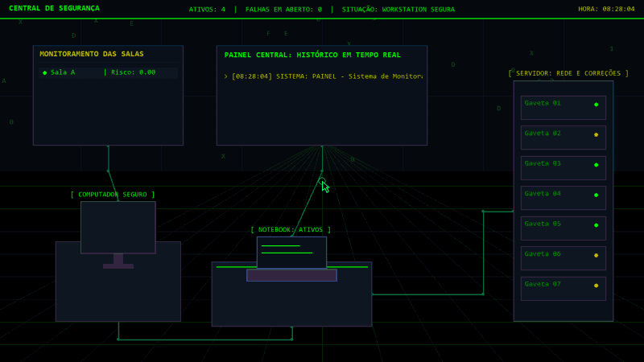
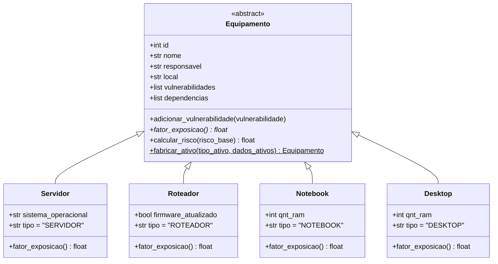

<div align="center">

# 🛡️ CyberPixel — Central de Segurança (SOC)

**Simulador Interativo de Centro de Operações de Segurança (SOC), Gestão de Ativos de TI, Vulnerabilidades (CVEs/NVD) e Propagação Matricial de Risco**


</div>

---

## 🎬 Demonstração: Do Registro da Falha à Correção Guiada pela NVD

Ao registrar e corrigir uma vulnerabilidade, o **CyberPixel SOC** recalcula instantaneamente o nível de ameaça da rede e atualiza todo o laboratório visual:

1. **Estado Seguro:** A Workstation e os LEDs das gavetas do Servidor operam em **verde Matrix**, com o painel central monitorando a rede sem alertas.
2. **Cadastro e Inspeção da Falha (`Workstation`):** Ao selecionar um equipamento e escolher uma vulnerabilidade (do catálogo local ou buscada ao vivo na **API da NVD**), o painel **Detalhes da Vulnerabilidade** exibe um resumo imediato e permite clicar para **expandir a explicação completa da falha** e sua **correção recomendada**.
3. **Reação Dinâmica do Cenário:** Assim que a falha é cadastrada, a Workstation passa a piscar conforme a escala de gravidade (**Âmbar → Laranja → Vermelho Claro → Vermelho Crítico**) com um alerta flutuante (`👾`), os LEDs do Servidor mudam de estado e o **Painel Central** destaca as ameaças em aberto.
4. **Topologia de Risco e Correção no Servidor (`Servidor: Rede e Correções`):** Clicando no rack do Servidor, você visualiza a **Árvore de Infraestrutura da Sala** (`Servidor → Roteador → Computadores`) com o impacto do risco propagado, seleciona a falha do aparelho, expande a **Sugestão de Correção da NVD** (com versão corrigida e link oficial de *patch*), preenche o relatório com **1 clique** em `USAR ESTA SUGESTÃO NA CORREÇÃO` e aplica a correção em `CORRIGIR FALHA`.

<div align="center">
  
</div>

---

## 🖥️ Estações Interativas do Cenário

Você interage clicando diretamente nos equipamentos do laboratório SOC:

| Estação no Cenário | Função no Sistema | O que você pode fazer |
| :--- | :--- | :--- |
| 💻 **Notebook** (`[ NOTEBOOK: ATIVOS ]`) | Gestão de Inventário (`CRUD`) | **Consultar / Buscar**, **Cadastrar**, **Atualizar** e **Remover** equipamentos (`Servidor`, `Roteador`, `Notebook`, `Desktop`) com prefixo automático de hostname (`serv`, `rotp`, `notp`, `micp`) e criação dinâmica de salas. |
| 🖥️ **Workstation** (`[ COMPUTADOR SEGURO / ALERTA ]`) | Cadastro de Vulnerabilidades | **Vincular falhas e CVEs** (catálogo didático local ou busca assíncrona na **NVD**) aos equipamentos da rede e consultar o card expansível com a explicação detalhada do erro. |
| 🗄️ **Servidor** (`[ SERVIDOR: REDE E CORREÇÕES ]`) | Rede, Risco e Correção de Falhas | Visualizar a **Árvore de Infraestrutura por Sala**, comparar o **Risco Próprio vs. Risco Efetivo**, inspecionar a **Sugestão Oficial da NVD** e **Corrigir falhas** diretamente com preenchimento automático da sugestão. |
| 📺 **Painel Central** (`Telão de Monitoramento`) | Histórico e Ameaças em Tempo Real | Alterna no cenário entre o **Histórico em Tempo Real** e as **Falhas em Aberto na Rede**, abrindo ao clicar um painel completo de auditoria das ações realizadas. |

---

## 🧬 Arquitetura Orientada a Objetos (POO)

O domínio de equipamentos em [`ativos.py`](ativos.py) foi modelado aplicando **Abstração**, **Herança**, **Polimorfismo** e o padrão **Simple Factory**:



<details>
<summary><b>🔍 Clique para ver como cada pilar de POO foi aplicado</b></summary>

<br>

* **Classe Abstrata (`ABC`):** `Equipamento` herda de `abc.ABC` e declara `@abstractmethod def fator_exposicao(self)`, garantindo que apenas equipamentos concretos sejam instanciados.
* **Herança (`super()`):** `Servidor`, `Roteador`, `Notebook` e `Desktop` herdam a estrutura base de `Equipamento` e estendem o modelo com atributos específicos (`sistema_operacional`, `firmware_atualizado`, `qnt_ram`).
* **Polimorfismo:** O método `calcular_risco()` na classe base invoca `self.fator_exposicao()`, cujo retorno varia polimorficamente conforme a classe concreta (`1.5` para servidores críticos e `0.8` para demais ativos). Além disso, vulnerabilidades registradas em instâncias de `Servidor` têm sua gravidade elevada automaticamente para `critica`.
* **Factory Method (`@staticmethod`):** `Equipamento.fabricar_ativo(tipo, dados)` reconstrói polimorficamente os objetos de domínio a partir dos dicionários carregados do JSON.

</details>

---

## 📐 Álgebra Linear Aplicada: Propagação Matricial de Risco

Nos módulos [`CRUD/risco.py`](CRUD/risco.py) e [`CRUD/risco_salas.py`](CRUD/risco_salas.py), o risco cibernético não fica isolado em um único aparelho: ele se propaga pela topologia da sala utilizando **Matrizes e Sistemas Lineares** com `NumPy`.

### 1. Vetor de Risco Próprio ($b$) via Produto Matricial
Para $n$ equipamentos e $m$ vulnerabilidades abertas:
* Constrói-se a **Matriz de Incidência** $M \in \mathbb{R}^{n \times m}$, onde $M_{i,j} = 1$ se o equipamento $i$ possui a vulnerabilidade ativa $j$ (e $0$ caso contrário).
* Define-se o **Vetor de Severidades** $v \in \mathbb{R}^{m}$ com os pesos: `baixa = 1.0`, `media = 2.5`, `alta = 5.0`, `critica = 10.0`.
* O risco base de todos os equipamentos é obtido pelo produto matricial (`np.dot(M, v)`), ponderado pelo fator de exposição polimórfico $f_i$ de cada classe:

$$b_i = f_i \cdot (M \cdot v)_i$$

### 2. Matriz de Dependências ($A$) e Sistema Linear $(I - A)x = b$
A rede de cada sala conecta **Computadores (`Notebook`/`Desktop`) $\leftrightarrow$ `Roteador` $\leftrightarrow$ `Servidor`**. A matriz quadrada $A \in \mathbb{R}^{n \times n}$ registra a fração de propagação de risco entre os equipamentos (incluindo propagação descendente do equipamento-pai e ascendente de $25\%$ dos dependentes).

Como o **Risco Efetivo** $x$ de cada máquina é a soma do seu risco próprio $b$ com o risco herdado das conexões ($x = Ax + b$), resolvemos o sistema linear:

$$(I - A)x = b$$

* **Verificação de Invertibilidade:** Calcula-se o determinante $\det(I - A)$ via `np.linalg.det`. Se $\det(I - A) \approx 0$, o sistema detecta dependência cíclica crítica e bloqueia o cálculo.
* **Resolução Direta:** Caso $\det(I - A) \neq 0$, o vetor de risco efetivo $x$ é resolvido com `np.linalg.solve(I - A, b)`.

---

## 🌐 Integração com a API Oficial NIST / NVD (CVE 2.0) e Sugestões de Correção

O seletor de vulnerabilidades consulta a API pública da **National Vulnerability Database (NVD)** em tempo real conforme o usuário digita (3+ caracteres):
* **Execução Assíncrona (`NvdCveSearchWorker`):** Implementado em [`integracoes/nvd_api.py`](integracoes/nvd_api.py) com `threading.Thread` e `Queue` para nunca travar o loop gráfico de 50 FPS do Pygame.
* **Extração Automática de Recomendações de Correção da NVD:** Ao normalizar cada CVE retornada pela API oficial, o sistema extrai e monta uma sugestão prática de mitigação contendo:
  1. **Ação Recomendada por Categoria (`weaknesses` / CWE):** Orientações em português baseadas no tipo da falha (`CWE-89` Injeção SQL, `CWE-79` XSS, `CWE-787` Corrupção de Memória, `CWE-287` Autenticação, `CWE-22` Path Traversal, `CWE-400` Negação de Serviço, etc.).
  2. **Versão Corrigida (`configurations` / `cpeMatch`):** Identifica automaticamente nos blocos CPE da NVD os campos `versionEndExcluding` e `versionEndIncluding` para indicar a partir de qual versão a falha foi corrigida.
  3. **Boletim Oficial / Patch (`references`):** Captura links oficiais classificados pela NVD com as tags `"Patch"`, `"Mitigation"` ou `"Vendor Advisory"`.
* **Fallback Offline Didático:** O catálogo local de vulnerabilidades (`Senha fraca`, `Credenciais padrão`, `Heartbleed`, `EternalBlue`, `Apache Struts`, `Log4Shell`, `Spring4Shell`) conta com explicações acessíveis e sugestões de correção prontas mesmo sem conexão com a internet.
* **Rate Limit & Cache:** Possui cache em memória e controle automático de *rate limit* (opcionalmente acelerado definindo a variável de ambiente `NVD_API_KEY`).

---

## 🚀 Como Executar o Projeto

### 1. Pré-requisitos
Certifique-se de ter o **Python 3.10+** instalado e instale as dependências:

```bash
pip install pygame-ce numpy
```
*(Ou `pip install pygame numpy` caso utilize a distribuição padrão do Pygame).*

### 2. Iniciando a Interface Visual (SOC)
```bash
python main_game.py
```

---

## 📂 Estrutura do Projeto

```text
trabalho02/
├── main_game.py                # Ponto de entrada e inicialização da aplicação gráfica (App)
├── ativos.py                   # Hierarquia POO (Equipamento, Servidor, Roteador, Notebook, Desktop)
├── vulnerabilidades.py         # Catálogo local de CVEs, registro e correção de incidentes
├── persistencia.py             # Leitura e gravação segura da base JSON (inventario_db.json)
├── inventario_db.json          # Base de dados persistente de ativos, topologia e vulnerabilidades
├── assets/
│   └── demo_vulnerabilidade.gif # Demonstração animada do fluxo completo no SOC
├── interface/                  # Pacote modular da interface gráfica (Pygame)
│   ├── configuracoes.py        # Paleta de cores, dimensões e textos didáticos/sugestões locais
│   ├── componentes.py          # Widgets interativos (CaixaTexto, CaixaSelecao com busca e truncamento)
│   ├── estado.py               # Gerenciamento de estado, sincronização e sugestões NVD/locais
│   ├── eventos.py              # Tratamento de cliques, atalhos, rolagem (scroll) e ações das estações
│   └── renderizacao.py         # Desenho do cenário SOC, árvore de infraestrutura e janelas modais
├── CRUD/
│   ├── cadastro.py             # Cadastro validado e amarração automática de topologia de rede
│   ├── consulta.py             # Consultas e filtros sobre o inventário de equipamentos
│   ├── atualizar.py            # Atualização cadastral e vínculo de dependências
│   ├── remover.py              # Remoção de ativos com limpeza de referências órfãs
│   ├── risco.py                # Cálculo matricial de risco global com NumPy
│   └── risco_salas.py          # Cálculo matricial de risco por sala (com propagação bidirecional)
└── integracoes/
    └── nvd_api.py              # Cliente HTTP, extração de patches/versões e Worker NVD em background
```

---

<details>
<summary><b>🛠️ Decisões de Arquitetura, Usabilidade e Engenharia de Software</b></summary>

<br>

Durante a evolução do projeto, tanto o motor de regras quanto a interface gráfica passaram por melhorias focadas em coesão, clareza visual e intuitividade:

* **Interface Modularizada (`interface/`):** A camada visual foi dividida em módulos coesos (`configuracoes.py`, `componentes.py`, `estado.py`, `eventos.py` e `renderizacao.py`), mantendo o [`main_game.py`](main_game.py) enxuto e fácil de entender.
* **Fluxo Intuitivo de Inspeção e Correção no Servidor:** A correção de vulnerabilidades foi integrada diretamente à estação do **Servidor**, permitindo clicar em qualquer equipamento da árvore da sala, visualizar suas falhas com rolagem (*scroll*), abrir o card expandido com a explicação do problema e preencher a sugestão de correção com um clique.
* **Prevenção Visual de Sobreposição (*Clipping* e Truncamento):** Todos os textos dinâmicos (nomes de falhas extensos da NVD, títulos, árvores de rede, listas e relatórios) contam com limites de largura, reticências automáticas (`...`) e recorte de área (`set_clip`), evitando qualquer sobreposição na tela.
* **Linguagem Acessível e Didática:** Os textos e alertas da interface foram revisados para explicar conceitos de Cibersegurança de forma clara e direta.

</details>
